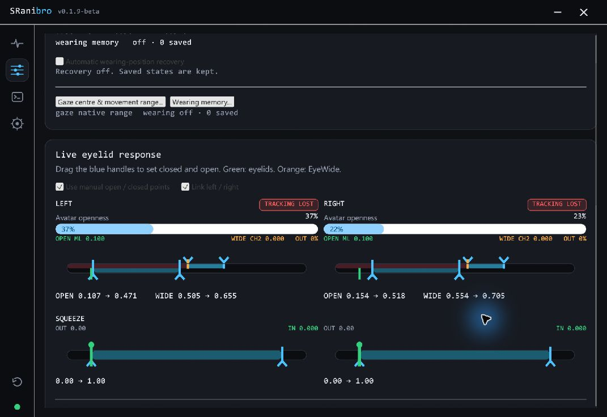
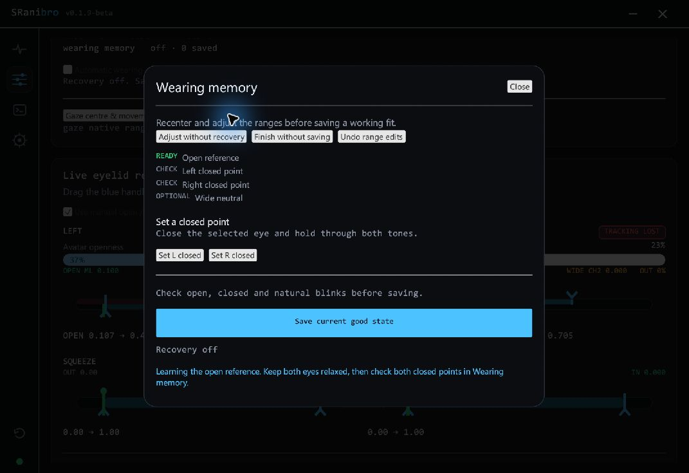

# SRanibro

Eye and eyelid tracking for VR. Bring gaze, blinks, EyeWide and eyebrows to VRCFaceTracking.

## Download

| Platform | Build | Headsets |
| --- | --- | --- |
| **Windows 10 / 11 x64** | **[v0.1.11-beta — download ZIP](https://github.com/challenger0303/SRanibro/releases/download/v0.1.11-beta/SRanibro-v0.1.11-beta-Windows.zip)** | Tobii-equipped, hot-mirror headsets, PSVR2, and Dream Air / SE (XR5 beta) |
| **Linux x86_64** | **[v0.1.9-beta — download tar.gz](https://github.com/challenger0303/SRanibro/releases/download/v0.1.9-beta/SRanibro-PSVR2-0.1.9-beta-linux-x86_64.tar.gz)** | **PSVR2 only · experimental** · glibc 2.39+ |

**Windowsはv0.1.11-beta。Linux版はPSVR2専用の実験版です。**

[English guide](USER_GUIDE.md) · [日本語ガイド](USER_GUIDE.ja.md) · [Release notes](https://github.com/challenger0303/SRanibro/releases/tag/v0.1.11-beta)

Extract the whole Windows ZIP. It includes the XR5 eyelid model, eyebrow model and VRCFT module; keep `models` and `model-runtime` beside the EXE. SRanipal model weights are not included.

### Headsets

- **Hot-mirror:** Pimax Crystal / Crystal Super (VR4), StarVR One, and Varjo through a supported camera path. Uses your SRanipal EyePrediction model.
- **PSVR2:** requires PSVR2Toolkit and SteamVR, plus your SRanipal model.
- **Dream Air / SE (XR5):** new settings use the bundled native model for openness and EyeWide, without Python or SRanipal. Squeeze is not supported by this model. The SRanipal + image-transform option remains available; existing selections are kept.

## Latest Windows update

v0.1.11-beta includes the current application code and opt-in experimental XR5 model-gaze integration. Native gaze remains the default; a compatible local gaze package is required for Model gaze. Personal gaze mappings are not bundled, and no new gaze/eyelid accuracy gain is claimed.

The separate **[XR5 Recorder v0.4.1](https://github.com/challenger0303/SRanibro/releases/download/v0.1.11-beta/SRanibro-XR5-Recorder-v0.4.1-TobiiReference.zip)** keeps a dot fixed in SteamVR space while the user moves their head, and records native Tobii gaze references with the eye images. Missing, stale and invalid references are kept explicit. Real-device timing, eye assignment and coordinate alignment still require validation.

## Adjust eyelids by eye

Watch the model response and drag the handles to set closed, open and Wide ranges. Changes apply live; no long calibration sequence is required. Squeeze has its own range when supported by the model.

## Keep a good fit

Save a wearing position after checking your blinks and winks. **Wearing Memory** can recall corrections when the camera view matches a saved state. Memories stay on your PC and are separated by headset.

UI screenshots from the pre-release build (v0.1.9 title). Tracking was unavailable during capture; no eye-camera images are shown.

## More controls, when you need them

- **Gaze:** adjust center and movement range; Crystal Super also has a gaze-source selector and optional smoothing.
- **Eyebrows:** link them to EyeWide, or use the included independent eyebrow model.
- **Camera output:** stream eye images to compatible software. XR5 supports up to 120 frames/s per eye; camera-only mode stops local model inference.
- **Performance:** GPU eyelid processing with CPU fallback, plus an optional camera preview.

## License

Application source is now available in [`sranibro-app`](sranibro-app/), except the private Tobii forced-access boundary described in [SOURCE_BOUNDARY.md](sranibro-app/SOURCE_BOUNDARY.md). The existing [application source notice](sranibro-app/SOURCE-LICENSE.md) permits review and research reference; it is not an MIT license. The Windows binary retains the private device-access backend. Binary redistribution terms are unchanged: link to the official release.

The separate [`sranibro-core`](sranibro-core/) source remains [MIT-licensed](sranibro-core/LICENSE). GitHub's generated source archives now also include the application source with the documented exclusions; no vendor runtime, authentication material, personal mappings or eye recordings are in the repository.

SRanibro is independent and is not affiliated with or endorsed by Tobii, HTC, Pimax, StarVR, Varjo, Sony, VRChat or VRCFaceTracking. Trademarks belong to their respective owners.
